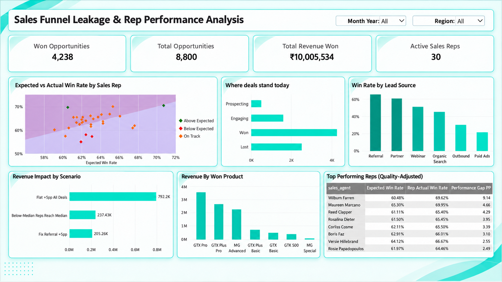

# Sales Funnel Leakage & Rep Performance Analysis



Win-rate leaderboards are easy to build and easy to misread. A rep with a queue full of warm referrals will win more than a rep working cold outbound leads, even if the second one is the better closer. I wanted to see how much of each rep's win rate comes from the leads they were handed, and what the business would gain from closing the gap.

Built with Python (pandas, matplotlib), PostgreSQL and Power BI.

## The data

The pipeline data is the CRM Sales Opportunities dataset from the [Maven Analytics Data Playground](https://mavenanalytics.io/data-playground): a B2B sales pipeline for a fictional computer hardware company. It has 8,800 opportunities, 30 active reps under 6 managers in 3 regional offices, 85 accounts and 7 products, with deals engaged between October 2016 and December 2017. Maven offers these files free for learning. I couldn't find a redistribution licence, so they are credited and linked here, and anything beyond reviewing this project should start from Maven's own download.

The source doesn't state a currency. I show amounts in ₹ throughout, to match the lead-cost column I generated.

**One table is simulated.** The Maven data starts at the pipeline stage, so it has no lead source, lead score or cost per lead. Real companies don't publish that kind of data because it shows what they pay to win a customer. I generated it with `generate_lead_sources.py` (fixed random seed, so you get the same file every time). The channel mix is set up to look like a B2B hardware seller: plenty of outbound, fewer referral and partner leads. Referral and partner leads score higher and close more often than outbound and paid ads.

I wrote that relationship into the simulation, so the win rates by lead source (Referral 65%, Paid Ads 21%) say nothing about real customers. Anything built on lead scores, including the quality-adjusted rep ranking below, demonstrates a method. It is not a verdict on those reps, who are fictional anyway.

## Cleaning

Done in `01_data_cleaning.ipynb`. Two real problems turned up:

- `"technolgy"` in the account sector column, fixed to `"technology"`
- `"GTXPro"` in the pipeline table against `"GTX Pro"` in the products table. Left alone, this silently drops those deals from any product join

Other things I checked and kept: 1,425 opportunities with no account, open deals with no close date (left out of win-rate maths but not deleted), and lost deals with a close value of 0, which is a real zero and not missing data. Every agent, product and account in the pipeline exists in its lookup table, no opportunity ID repeats, and no deal closes before it starts.

## What the real data says

- 63.15% of the 6,711 decided deals were won: 4,238 won, 2,473 lost. Another 1,589 are still engaging and 500 are at prospecting. Won revenue is ₹10,005,534, about ₹2,361 per won deal.
- Win rate by month of first engagement was above 80% for late 2016 (few deals), fell through early 2017, and sat between about 55% and 66% from April to November. December is higher at 78%, but that rests on only 103 decided deals.
- Won deals take longer to close than lost ones: 51.8 days on average against 41.5.
- Rep win rates run from 55.0% to 70.4% before any adjustment.
- Manager win rates sit between 62.1% and 64.4%. West has the best win rate (63.9%) and the most revenue of the three regions.
- Product and sector barely matter. Every win rate falls between 60% and 65%.
- If the 15 reps below the median win rate had reached the median, that's about ₹237,000 more revenue. A flat five-point lift on every decided deal would add about ₹792,000. Both figures use only real win rates and deal values.

## The rep model (on simulated lead scores)

For each decided deal I put the lead score into one of five buckets (cut points at 45.8, 58.9, 71.0 and 82.9), then worked out the company-wide win rate in each bucket. A rep's expected win rate is the average of those bucket rates across the deals they worked. The gap is their actual win rate minus the expected one.

Wilburn Farren comes out +9.1 points and Maureen Marcano +4.7. Lajuana Vencill is at -6.9 and Garret Kinder at -6.4. Garret's raw win rate looks fine because his leads were strong, and the gap shows that. Treat the names as an illustration of how the model reads, since the expected rates come from lead scores I simulated.

## Dashboard

One Power BI page with slicers for month and region. The measures are written in DAX on top of the five cleaned tables, with relationships set in the model. Nothing is pre-aggregated outside Power BI. It covers deal stages, win rate by lead source, expected against actual win rate per rep, revenue by product, three revenue scenarios and the top reps by gap.

## Limits

Reps have between 79 and 553 decided deals each, so a gap smaller than about 5 points is within what chance alone produces. The data covers one year of a fictional company. Nothing here is causal, and the whole lead-quality layer is simulated.

## Run it yourself

1. `pip install pandas matplotlib jupyter nbformat sqlalchemy psycopg2-binary python-dotenv`
2. Optional: regenerate the simulated table with `cd data` then `python ../generate_lead_sources.py`
3. Run `01_data_cleaning.ipynb`. It reads `data/` and writes `data_cleaned/`.
4. For SQL, copy `.env.example` to `.env` and put your PostgreSQL details in it, run `load_to_postgres.py`, then run `sales_funnel_analysis_queries.sql` in pgAdmin.
5. Run `02_main_analysis.ipynb`.
6. Open `dashboard/sales_funnel_dashboard.pbix`. If the refresh fails, go to Transform data, then Data source settings, and point it at the `data_cleaned/` folder.

## Files

```
data/                              Maven tables + simulated lead_sources.csv
data_cleaned/                      output of the cleaning notebook
dashboard/                         .pbix file and screenshot
01_data_cleaning.ipynb
02_main_analysis.ipynb
generate_lead_sources.py           builds the simulated lead table
load_to_postgres.py                loads cleaned CSVs into PostgreSQL
.env.example                       template for your database login (copy to .env)
sales_funnel_analysis_queries.sql  all SQL queries
```

Data credit: Maven Analytics, CRM Sales Opportunities.
